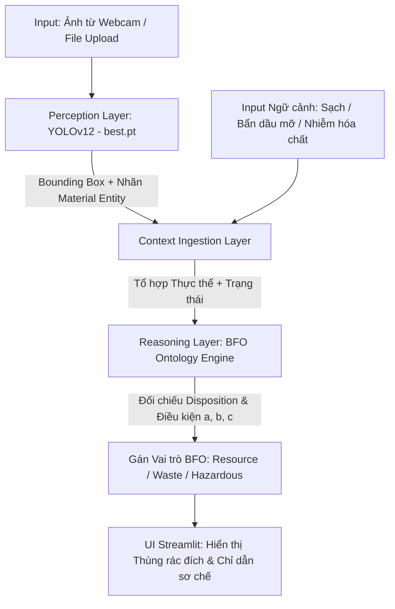

# ♻️ Context-Aware Waste Detection & Ontological Recycling Advisory System
### *Tác tử AI Nhận diện Rác thải & Tư vấn Tái chế dựa trên Bản thể học Ngữ cảnh*

[](https://www.python.org/)
[](https://docs.ultralytics.com/)
[](https://basic-formal-ontology.org/)
[](https://streamlit.io/)
[](https://hust.edu.vn/)

---

## 📌 1. Giới thiệu Tổng quan (Project Overview)

Dự án **Context-Aware Waste Detection & Ontological Recycling Advisory System** được phát triển trong khuôn khổ học phần **Nhập môn Trí tuệ Nhân tạo (HUST)**. Khắc phục hạn chế của các hệ thống phân loại rác truyền thống vốn coi "rác" là một thuộc tính tĩnh của vật liệu, hệ thống này kết hợp hai công trình nghiên cứu mới công bố năm **2025**:

1. **Tầng Cảm nhận Thị giác (Perception Layer - YOLOv12):** Kế thừa kiến trúc **YOLOv12** (*Dipo et al., 2025*) tích hợp cơ chế *Area Attention* và *R-ELAN* giúp định vị và trích xuất chính xác thực thể vật chất (*Material Entity*) của vật thể trong thời gian thực.
2. **Tầng Suy luận Bản thể học Ngữ cảnh (Reasoning Layer - BFO Ontology):** Ứng dụng khung **Basic Formal Ontology (BFO)** (*Milivinti, 2025*), định nghĩa "rác" hay "tài nguyên tái chế" là một **Vai trò động (*Role*)** phụ thuộc vào sự kết hợp giữa **Đặc tính cố hữu (*Disposition*)** của vật liệu và **Ngữ cảnh vật lý/kinh tế (*Context*)** tại thời điểm phân loại.
3. **Tầng Tương tác Trạm phân loại (Human-in-the-loop Action Layer):** Giao diện Web Streamlit tại trạm thu gom thông minh, kết hợp kết quả nhận diện từ camera với thông tin ngữ cảnh để đưa ra phán quyết thùng rác quy chuẩn và quy trình sơ chế tại nguồn.

---

## 🧠 2. Nền tảng Lý thuyết AI (AI Framework Alignment)

### 2.1. Mô hình Tác tử PEAS
* **P (Performance Measure - Độ đo hiệu năng):**
  * Chỉ số định vị và phân loại vật liệu: $\text{mAP@0.5} \ge 0.78$, $\text{F1-Score} \ge 0.75$ trên tập kiểm thử đã chuẩn hóa.
  * Tỷ lệ suy diễn đúng vai trò (*Role Assignment*) theo tiêu chuẩn BFO đạt $100\%$ dựa trên tổ hợp *(Thực thể + Ngữ cảnh)*.
  * Không bỏ sót nhóm mang đặc tính nguy hại (`ToxicityHazard`) sang luồng rác sinh hoạt thông thường.
  * Thời gian phản hồi suy luận trên ảnh đơn $< 0.5\text{s}$ (trên CPU laptop cá nhân).
* **E (Environment - Môi trường):**
  * Trạm phân loại rác tại nguồn (tòa nhà, trường học) với điều kiện ánh sáng đa dạng, vật thể có thể bị móp méo hoặc chồng lấp.
  * Môi trường **Quan sát được một phần (*Partially Observable*)**: Camera 2D nhận diện được hình thái bề mặt vật liệu nhưng cần bổ sung tín hiệu ngữ cảnh (độ nhiễm bẩn hóa chất/dầu mỡ, tính nguyên vẹn) từ người dùng hoặc cảm biến phụ trợ.
* **A (Actuators - Cơ cấu tác động):**
  * Giao diện Streamlit hiển thị Bounding Box, nhãn thực thể vật chất và điểm độ tin cậy (*Confidence score*).
  * Thẻ Phán quyết Suy luận (*Ontological Reasoning Card*) giải thích rõ: Thực thể $\rightarrow$ Đặc tính cố hữu $\rightarrow$ Vai trò theo ngữ cảnh $\rightarrow$ Thùng rác đích & Hướng dẫn xử lý.
* **S (Sensors - Cảm biến):**
  * Camera/Webcam hoặc module tải tệp ảnh kỹ thuật số (`.jpg`, `.png`).
  * Bộ chọn ngữ cảnh (*Context Selectors*) trên giao diện đóng vai trò cảm biến trạng thái vật lý và điều kiện hạ tầng thu gom.

### 2.2. Mô hình Học máy $(T, P, E)$ ở Tầng Thị giác
* **T (Task - Nhiệm vụ):** Phát hiện đối tượng (*Object Detection*) và phân loại thực thể vật chất vào 6 nhóm chuẩn hóa: `Plastic`, `Metal_Battery`, `Paper`, `Glass`, `Organic`, `Medical`.
* **P (Performance - Đánh giá):** $\text{Precision}$, $\text{Recall}$, $\text{F1-Score}$, $\text{mAP@0.5}$, $\text{mAP@0.5:0.95}$ và Ma trận nhầm lẫn (*Confusion Matrix*).
* **E (Experience - Kinh nghiệm):** Tập dữ liệu thực tế từ nghiên cứu của *Dipo et al. (2025)* (~7.300 ảnh), được tiền xử lý gom nhãn từ 18 lớp phân mảnh về 6 lớp vật liệu cốt lõi để khắc phục hiện tượng nhiễu và mất cân bằng dữ liệu.

### 2.3. Biểu diễn Tri thức & Suy luận BFO (Knowledge Representation)
Dựa trên *Milivinti (2025)*, tri thức không viết dưới dạng `if-else` tĩnh mà được mô hình hóa qua 4 thực thể BFO:
* **Material Entity ($\text{BFO:0000040}$):** Thực thể vật chất độc lập do YOLOv12 phát hiện (ví dụ: `PlasticBottle`, `Battery`).
* **Function ($\text{BFO:0000034}$):** Công năng thiết kế ban đầu (ví dụ: `ContainmentFunction`, `EnergyStorageFunction`).
* **Disposition ($\text{BFO:0000016}$):** Đặc tính vật lý cố hữu (`MechanicalRecyclability`, `ToxicityHazard`, `Biodegradability`).
* **Role ($\text{BFO:0000023}$):** Vai trò được gán dựa trên điều kiện ngữ cảnh $(a, b, c)$:
  $$\text{HasRole}(x, \text{RecyclableResource}) \iff \text{MaterialEntity}(x) \land \text{HasDisposition}(x, \text{Recyclability}) \land \text{Context}(x, \text{Clean}) \land \text{InfraAvailable}(\text{True})$$
  $$\text{HasRole}(x, \text{NonRecyclableWaste}) \iff \text{MaterialEntity}(x) \land \text{HasDisposition}(x, \text{Recyclability}) \land \text{Context}(x, \text{ChemicalContaminated})$$

---

## 🏗️ 3. Kiến trúc Hệ thống & Luồng Dữ liệu (System Architecture)



---

## 📂 4. Cấu trúc Thư mục Dự án (Project Structure)

```text
Intro-to-AI-Project/
│
├── data/                           # [CHỈ LƯU LOCAL/COLAB - Đưa vào .gitignore, KHÔNG đẩy lên GitHub]
│   ├── raw/                        # Dataset 18 lớp tải nguyên bản từ Roboflow (7.3k ảnh)
│   ├── processed/                  # Dataset sau khi chạy script gộp về 6 lớp chuẩn Paper 1
│   │   ├── train/                  # Ảnh (.jpg) và nhãn (.txt) dùng để huấn luyện
│   │   ├── valid/                  # Ảnh và nhãn dùng để kiểm định trong lúc học
│   │   └── test/                   # Ảnh và nhãn dùng để đánh giá độc lập
│   └── data.yaml                   # File khai báo đường dẫn và danh sách 6 tên lớp cho YOLOv12
│
├── scripts/                        # Thư mục chứa script tiền xử lý dữ liệu
│   └── remap_labels.py             # Script đọc file .txt, đổi chỉ số 18 lớp -> 6 lớp và lọc nhãn lỗi
│
├── notebooks/                      # Chứa Jupyter Notebook chạy trên đám mây
│   └── train_yolov12_colab.ipynb   # Notebook tải data, huấn luyện YOLOv12 trên GPU T4 và xuất kết quả
│
├── models/                         # Chứa kết quả sinh ra sau khi huấn luyện trên Colab
│   ├── best.pt                     # Trọng số YOLOv12 đã huấn luyện hoàn chỉnh
│   └── metrics/                    # Ảnh chụp Confusion Matrix, biểu đồ Loss/mAP phục vụ báo cáo
│
├── knowledge/                      # Tầng Suy luận Tri thức theo Paper 2 (BFO Ontology)
│   ├── waste_bfo.owl               # File bản thể học chuẩn xuất từ phần mềm Protégé
│   └── waste_rules.py              # Module Python định nghĩa MaterialEntity, Disposition, Role và hàm suy diễn
│
├── app.py                          # Ứng dụng giao diện Web Streamlit (Nối models/best.pt với knowledge/waste_rules.py)
├── train.py                        # Script huấn luyện dự phòng bằng dòng lệnh
├── requirements.txt                # Danh mục các thư viện cần cài đặt trên máy cá nhân
├── .gitignore                      # Chặn đẩy thư mục data/ và môi trường ảo lên GitHub
├── PROJECT_CONTEXT.md              # Tài liệu đặc tả kiến trúc và cơ sở học thuật của dự án
├── CONTRIBUTING.md                 # Quy tắc làm việc nhóm và quản lý nhánh Git
└── README.md                       # Tài liệu tổng quan và hướng dẫn sử dụng dự án
```

---

## 🚀 5. Phân bổ Công cụ & Hướng dẫn Cài đặt (Getting Started)

Dự án tách biệt môi trường huấn luyện nặng (trên đám mây) và môi trường chạy ứng dụng nhẹ (trên máy cá nhân):

### 5.1. Giai đoạn Huấn luyện trên Đám mây (Google Colab - GPU T4)
1. Mở tệp `notebooks/train_yolov12_colab.ipynb` trên **Google Colab** (chọn Runtime $\rightarrow$ Change runtime type $\rightarrow$ **T4 GPU**).
2. Chạy các ô lệnh để tải bộ dữ liệu từ Roboflow Universe và thực thi `scripts/remap_labels.py` nhằm chuẩn hóa 18 lớp về 6 lớp.
3. Huấn luyện mô hình YOLOv12 trong $50 - 100$ epochs (~2 giờ).
4. Tải tệp trọng số `best.pt` và các biểu đồ trong thư mục `runs/detect/train` về máy tính, đặt vào thư mục `models/`.

### 5.2. Giai đoạn Chạy Ứng dụng Web trên Máy cá nhân (Local Laptop)
1. **Clone repository về máy:**
   ```bash
   git clone https://github.com/your-username/Intro-to-AI-Project.git
   cd Intro-to-AI-Project
   ```

2. **Khởi tạo môi trường ảo Python (3.10+):**
   * Trên Windows:
     ```powershell
     python -m venv venv
     .\venv\Scripts\activate
     ```
   * Trên Linux / macOS:
     ```bash
     python3 -m venv venv
     source venv/bin/activate
     ```

3. **Cài đặt thư viện phụ thuộc:**
   ```bash
   pip install -r requirements.txt
   ```

4. **Khởi chạy Trạm phân loại rác ảo (Streamlit Web App):**
   ```bash
   streamlit run app.py
   ```
   Truy cập ứng dụng tại địa chỉ: `http://localhost:8501`.

---

## 🖥️ 6. Kịch bản Sử dụng Sản phẩm (Product Workflow)

1. **Đầu vào (Input):**
   * **Thị giác:** Người dùng tải lên một bức ảnh chứa một hoặc nhiều vật thể rác (ví dụ: vỏ chai nhựa nằm cạnh viên pin cũ) hoặc chụp trực tiếp qua Webcam.
   * **Ngữ cảnh (Context):** Người dùng chọn trạng thái thực tế của vật thể trên thanh công cụ:
     * *Tình trạng vật lý:* `Sạch & Nguyên vẹn` / `Bám bẩn dầu mỡ thực phẩm` / `Nhiễm hóa chất độc hại`.
     * *Hạ tầng tại chỗ:* `Có trạm thu hồi tái chế` / `Chỉ có thùng rác sinh hoạt chung`.
2. **Đầu ra (Output):**
   * **Khung ảnh trực quan:** Hiển thị Bounding Box bao quanh từng vật thể kèm nhãn `Material Entity` và độ tin cậy ($\%$).
   * **Thẻ Phán quyết BFO (Reasoning Card):**
     * *Trường hợp 1:* `Plastic` + `Sạch` $\rightarrow$ Gán vai trò **`Recyclable Resource`** $\rightarrow$ Chỉ định **Thùng Xanh Dương/Vàng** (Hướng dẫn: Tháo nắp, ép dẹp vỏ chai).
     * *Trường hợp 2:* Cùng bức ảnh `Plastic` đó nhưng chọn ngữ cảnh `Nhiễm hóa chất/Dầu mỡ nặng` $\rightarrow$ Hệ thống tự động suy diễn lại, chuyển vai trò thành **`Non-Recyclable / Hazardous Waste`** $\rightarrow$ Cảnh báo bỏ vào **Thùng Đỏ/Xám** để không làm hỏng lô nhựa tái chế.

---

## 👥 7. Phân công Vai trò Nhóm (Team Roles)

| Thành viên | Vai trò | Nhiệm vụ cụ thể |
| :--- | :--- | :--- |
| **TV1** | **System Architect & Lead** | Thiết kế kiến trúc kết nối 2 bài báo; lập bảng ánh xạ thực thể BFO (`Material` $\rightarrow$ `Disposition` $\rightarrow$ `Role`); vẽ sơ đồ Ontology trên Protégé. |
| **TV2** | **Data Engineer** | Tải dataset 7.3k ảnh từ Roboflow; viết script `scripts/remap_labels.py` gom 18 nhãn về 6 nhãn chuẩn; cấu hình `data.yaml` và thống kê phân phối dữ liệu. |
| **TV3** | **ML Engineer** | Thiết lập notebook `train_yolov12_colab.ipynb`; chạy huấn luyện YOLOv12 trên GPU T4 của Google Colab; trích xuất `best.pt` và các biểu đồ đánh giá (mAP, Confusion Matrix). |
| **TV4** | **Knowledge Engineer** | Lập trình module `knowledge/waste_rules.py` hiện thực hóa cấu trúc lớp BFO và hàm suy diễn vai trò rác dựa trên ngữ cảnh theo đúng 3 điều kiện của Paper 2. |
| **TV5** | **UI/UX & Integration** | Xây dựng giao diện `app.py` bằng Streamlit; tích hợp mô hình `best.pt` và bộ suy luận `waste_rules.py`; thiết kế thanh chọn ngữ cảnh và chạy kiểm thử kịch bản demo. |

---

## 📚 8. Tài liệu Tham khảo Chính (Key References)

1. **Dipo, M. H., Farid, F. A., Mahmud, M. S. A., Momtaz, M., Rahman, S., Uddin, J., & Karim, H. A. (2025).** *Real-Time Waste Detection and Classification Using YOLOv12-Based Deep Learning Model.* Digital, 5(2), 19. https://www.mdpi.com/2673-6470/5/2/19
2. **Milivinti, E. (2025).** *The Interoperability Challenge in Waste Management: An Ontological Approach.* Proceedings of FOIS 2025 Satellite Events, CEUR Workshop Proceedings, Vol. 4111. https://ceur-ws.org/Vol-4111/ECS_Paper_1.pdf
3. **Dataset gốc:** [Waste-Detection Computer Vision Dataset (MMT / Roboflow Universe)](https://universe.roboflow.com/) & [YOLOv12 Waste Dataset GitHub](https://github.com/MosharofHossainDipo/yolov12_dataset).
4. **Russell, S. J., & Norvig, P. (2020).** *Artificial Intelligence: A Modern Approach (4th ed.).* Pearson. (Giáo trình tham khảo chính học phần Nhập môn TTNT - HUST).