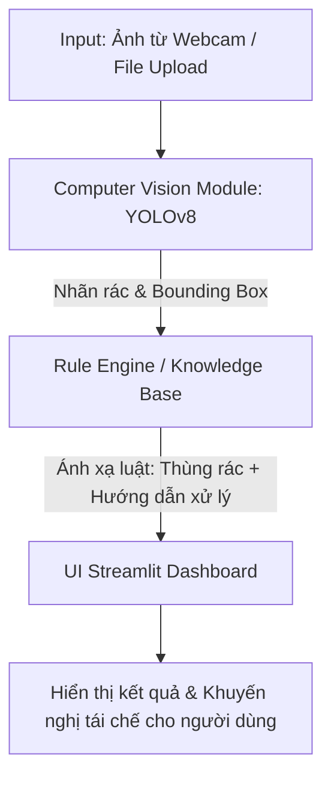

# ♻️ Waste Classification & Recycling Advisory System
### *Tác tử AI Phân loại Rác thải & Hướng dẫn Tái chế Thông minh*

[](https://www.python.org/)
[](https://docs.ultralytics.com/)
[](https://streamlit.io/)
[](https://hust.edu.vn/)

---

## 📌 1. Giới thiệu Tổng quan (Project Overview)

Dự án **Waste Classification & Recycling Advisory System** được phát triển trong khuôn khổ môn học **Nhập môn Trí tuệ Nhân tạo (HUST)**. 

Hệ thống đóng vai trò như một **Tác tử Thông minh (Intelligent Agent)** toàn diện:
1. **Tiếp nhận & Nhận diện (Perception):** Sử dụng thị giác máy tính (Computer Vision) để phát hiện và phân loại các loại rác thải từ hình ảnh tải lên hoặc camera trực tiếp.
2. **Suy luận & Ra quyết định (Reasoning):** Truy vấn cơ sở tri thức (Knowledge Base) và hệ luật chuyên gia (Rule Engine) để xác định mức độ nguy hại, màu thùng rác quy chuẩn và quy trình xử lý, tái chế tương ứng tại nguồn.
3. **Tương tác (Action):** Hiển thị trực quan kết quả, bounding box, thông tin chỉ dẫn chi tiết trên giao diện Web Streamlit dễ sử dụng.

---

## 🧠 2. Nền tảng Lý thuyết AI (AI Framework Alignment)

Hệ thống được thiết kế bám sát chặt chẽ các nguyên lý cốt lõi của môn học:

### 2.1. Mô hình Tác tử PEAS (Phát triển từ bài toán Tác tử nhặt rác)
* **P (Performance Measure - Độ đo hiệu năng):**
  * Độ chính xác phân loại tổng thể $\ge 90\%$.
  * Giảm thiểu tối đa sai sót nghiêm trọng (đặc biệt không nhầm rác nguy hại thành rác sinh hoạt).
  * Thời gian phản hồi tác tử $< 1.5$s trên ảnh đơn.
* **E (Environment - Môi trường):**
  * Môi trường thực tế: Rác sinh hoạt, rác công cộng với góc chụp đa dạng, bị biến dạng, bẩn hoặc che khuất một phần.
  * Hệ thống phân loại rác đích: Thùng Tái chế (Vàng/Xanh dương), Thùng Hữu cơ (Xanh lá), Thùng Rác vô cơ/còn lại (Xám/Đen), Thùng Rác nguy hại (Đỏ/Cam).
* **A (Actuators - Cơ cấu tác động):**
  * Giao diện Streamlit hiển thị Bounding Box, tên phân loại, thanh đo độ tin cậy (Confidence score).
  * Hộp cảnh báo màu thùng rác và bản hướng dẫn quy trình sơ chế/tái chế rác tại nguồn.
* **S (Sensors - Cảm biến):**
  * Cảm biến ảnh kỹ thuật số qua Webcam hoặc module tải tệp ảnh (`.jpg`, `.png`).

### 2.2. Mô hình Học máy $(T, P, E)$
* **T (Task - Nhiệm vụ):** Phân loại và định vị rác thải vào các nhóm: Nhựa (*Plastic*), Giấy (*Paper*), Kim loại (*Metal*), Thủy tinh (*Glass*), Hữu cơ (*Organic*), Nguy hại (*Hazardous - Pin, ắc quy, bóng đèn,...*).
* **P (Performance - Đánh giá hiệu năng):** Accuracy, Precision, Recall, F1-Score và Ma trận nhầm lẫn (Confusion Matrix) trên tập kiểm thử độc lập.
* **E (Experience - Kinh nghiệm):** Tập dữ liệu ảnh có gán nhãn được phân chia theo chuẩn **80% Train – 20% Test/Validation** để chống hiện tượng quá khớp (Overfitting).

### 2.3. Cơ sở Tri thức & Hệ luật (Knowledge Base & Rules)
* Biểu diễn tri thức dạng thuộc tính: $\text{Prop}(\text{Đối tượng}, \text{Thuộc tính}, \text{Giá trị})$.
* Áp dụng suy diễn tiến với luật sản xuất:
  $$\text{IF } \text{Class} = \text{'Battery'} \text{ THEN } \text{Bin} = \text{'Nguy hại'} \land \text{Action} = \text{'Không vứt thùng thông thường, đem đến điểm thu gom pin'}$$

---

## 🏗️ 3. Kiến trúc Hệ thống & Luồng Dữ liệu (System Architecture)



### Chi tiết luồng thực thi:
1. Người dùng chụp ảnh qua webcam hoặc tải ảnh rác lên giao diện Streamlit.
2. Mô-đun Computer Vision (**YOLOv8** hoặc **CNN**) nhận diện vị trí và gán nhãn rác (`plastic_bottle`, `battery`, `can`,...).
3. Kết quả nhãn được gửi sang mô-đun **Knowledge Base (`knowledge/waste_rules.py`)**.
4. Tập luật phân tích nhãn, xác định nhóm rác, màu thùng quy chuẩn và quy trình xử lý tại nguồn.
5. Giao diện trực quan hóa thông tin kèm chỉ dẫn chi tiết cho người dùng.

---

## 📂 4. Cấu trúc Thư mục Dự án (Project Structure)

```text
Intro-to-AI-Project/
│
├── data/                    # Dữ liệu ảnh phân loại (không commit lên git)
│   ├── train/               # 80% ảnh gán nhãn huấn luyện
│   └── test/                # 20% ảnh kiểm thử độc lập
│
├── models/                  # Nơi lưu trọng số mô hình đã huấn luyện
│   └── best.pt              # Trọng số YOLOv8 tốt nhất
│
├── knowledge/               # Cơ sở tri thức môn học
│   └── waste_rules.py       # Tập luật IF...THEN và dữ liệu quy chuẩn rác
│
├── notebooks/               # Jupyter notebooks thực nghiệm / EDA
│
├── train.py                 # Script huấn luyện & xuất ma trận nhầm lẫn
├── app.py                   # Ứng dụng giao diện Web Streamlit
├── requirements.txt         # Danh mục các thư viện phụ thuộc
├── PROJECT_CONTEXT.md       # Bối cảnh & tài liệu đặc tả dự án
├── CONTRIBUTING.md          # Hướng dẫn đóng góp & làm việc nhóm
└── README.md                # Tài liệu tổng quan dự án
```

---

## 🚀 5. Hướng dẫn Cài đặt & Chạy Thực nghiệm (Getting Started)

### 5.1. Yêu cầu Hệ thống
* Hệ điều hành: Windows, macOS hoặc Linux.
* Phiên bản Python: **Python 3.10+**.
* Trình quản lý gói: `pip` hoặc `conda`.

### 5.2. Các bước Cài đặt

1. **Clone repository về máy:**
   ```bash
   git clone https://github.com/your-username/Intro-to-AI-Project.git
   cd Intro-to-AI-Project
   ```

2. **Khởi tạo môi trường ảo (Khuyến nghị):**
   * Trên Windows:
     ```powershell
     python -m venv venv
     .\venv\Scripts\activate
     ```
   * Trên Linux / macOS:
     ```bash
     python3 -m venv venv
     source venv/bin/activate
     ```

3. **Cài đặt các thư viện cần thiết:**
   ```bash
   pip install -r requirements.txt
   ```

### 5.3. Huấn luyện Mô hình (ML Training)
Chuẩn bị dữ liệu trong thư mục `data/` theo đúng cấu trúc, sau đó chạy:
```bash
python train.py
```
Sau khi hoàn tất, trọng số tối ưu sẽ tự động được lưu vào `models/best.pt`.

### 5.4. Chạy Giao diện Demo (Streamlit App)
Khởi chạy ứng dụng Web cục bộ:
```bash
streamlit run app.py
```
Mở trình duyệt web theo địa chỉ: `http://localhost:8501`.

---

## 👥 6. Phân công Vai trò Nhóm (Team Roles)

| Thành viên | Vai trò | Trách nhiệm chính |
| :--- | :--- | :--- |
| **TV1** | **Project Manager & Architect** | Thiết lập kiến trúc PEAS, $(T, P, E)$, cấu trúc repo và kết nối các module |
| **TV2** | **Data Engineer** | Thu thập dataset (TACO, TrashNet), lọc làm sạch, chia train/test (80/20) |
| **TV3** | **Machine Learning Engineer** | Viết pipeline huấn luyện `train.py`, tinh chỉnh mô hình, xuất `best.pt` |
| **TV4** | **Knowledge Engineer** | Xây dựng cơ sở tri thức `waste_rules.py` và tập luật suy diễn |
| **TV5** | **UI/UX & Tester** | Xây dựng giao diện `app.py` với Streamlit, tích hợp và chạy kịch bản kiểm thử |

---

## 📅 7. Kế hoạch Thực hiện 4 Tuần (Roadmap)

* **Tuần 1:** Thống nhất kiến trúc PEAS, chuẩn bị môi trường, thu thập và tiền xử lý dữ liệu.
* **Tuần 2:** Huấn luyện mô hình cơ sở (Baseline), xây dựng cơ sở tri thức và tập luật ban đầu.
* **Tuần 3:** Tinh chỉnh mô hình (Fine-tuning), ghép nối Computer Vision với Knowledge Base và dựng giao diện Streamlit.
* **Tuần 4:** Đánh giá hiệu năng $(P)$, kiểm thử toàn diện, hoàn thiện tài liệu báo cáo và chuẩn bị video demo.

---

## 📚 8. Tài liệu Tham khảo & Nguồn Dữ liệu (References)

* **Datasets:**
  * [TACO (Trash Annotations in Context)](https://tacodataset.org/)
  * [TrashNet / Garbage Classification on Kaggle](https://www.kaggle.com/datasets/mostafaabla/garbage-classification)
  * [Trash-ICRA19 Dataset](http://marine.acfr.usyd.edu.au/datasets/)
* **Thư viện & Công cụ:**
  * [Ultralytics YOLOv8 Documentation](https://docs.ultralytics.com/)
  * [Streamlit Official Documentation](https://docs.streamlit.io/)
  * Giáo trình *Trí tuệ Nhân tạo* - Trường CNTT&TT, Đại học Bách khoa Hà Nội (HUST).

---

> Chi tiết về quy trình cộng tác mã nguồn và đóng góp cho dự án xem tại [CONTRIBUTING.md](file:///c:/Users/Admin/Documents/GitHub/Intro-to-AI-Project/CONTRIBUTING.md).
