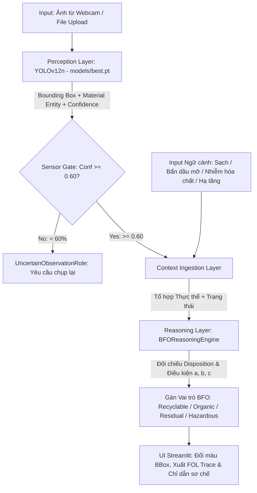

# ♻️ Context-Aware Waste Detection & Ontological Recycling Advisory System
### *Tác tử AI Nhận diện Rác thải & Tư vấn Tái chế dựa trên Bản thể học Ngữ cảnh*

[](https://www.python.org/)
[](https://docs.ultralytics.com/)
[](#4-kết-quả-thực-nghiệm-experimental-results)
[](#4-kết-quả-thực-nghiệm-experimental-results)
[](https://basic-formal-ontology.org/)
[](https://streamlit.io/)
[](https://hust.edu.vn/)

---

## 📌 1. Giới thiệu Tổng quan (Project Overview)

Dự án **Context-Aware Waste Detection & Ontological Recycling Advisory System** được phát triển trong khuôn khổ học phần **Nhập môn Trí tuệ Nhân tạo (HUST)**. Khắc phục hạn chế của các hệ thống phân loại rác truyền thống vốn coi *"rác"* là một thuộc tính tĩnh gắn cứng với vật liệu, hệ thống này kết hợp hai công trình nghiên cứu mới công bố năm **2025**:

1. **Tầng Cảm nhận Thị giác (Perception Layer - YOLOv12):** Kế thừa kiến trúc **YOLOv12n** (*Dipo et al., 2025*) tích hợp cơ chế *Area Attention ($A^2$)* và *R-ELAN* giúp định vị và trích xuất chính xác 6 nhóm Thực thể Vật chất (*Material Entity*) trong thời gian thực.
2. **Tầng Suy luận Bản thể học Ngữ cảnh (Reasoning Layer - BFO Ontology):** Ứng dụng khung **Basic Formal Ontology (BFO)** (*Milivinti, 2025*), định nghĩa *"rác"* hay *"tài nguyên tái chế"* là một **Vai trò động (*Role - BFO:0000023*)** phụ thuộc vào sự kết hợp giữa **Đặc tính cố hữu (*Disposition - BFO:0000016*)** của vật liệu và **Ngữ cảnh vật lý/kinh tế (*Spatiotemporal Context*)** tại thời điểm phân loại.
3. **Tầng Tương tác Trạm phân loại (Human-in-the-loop Action Layer):** Giao diện Web Streamlit (`app.py`) gồm 3 phân hệ: *Trạm Phân loại & Tư vấn BFO (Live Agent)*, *Kiểm định Thực nghiệm YOLOv12 (Metrics & Benchmark)* và *Cơ sở Tri thức Bản thể học (BFO Knowledge Base)*.

---

## 🧠 2. Nền tảng Lý thuyết AI (AI Framework Alignment)

### 2.1. Mô hình Tác tử PEAS
* **P (Performance Measure - Độ đo hiệu năng):**
  * Chỉ số định vị và phân loại vật liệu: Đạt **$\text{mAP@0.5} = 86.12\%$** (mục tiêu $\ge 78\%$) và **$\text{F1-Score} = 84.31\%$** (mục tiêu $\ge 75\%$).
  * Tỷ lệ suy diễn đúng vai trò (*Role Assignment*) theo tiêu chuẩn BFO đạt $100\%$ dựa trên tổ hợp *(Thực thể + Đặc tính + Ngữ cảnh)*.
  * Cơ chế **Zero-tolerance**: Tuyệt đối không bỏ sót nhóm mang đặc tính nguy hại (`ToxicityHazard`, `InfectiousBiohazard`) sang luồng rác sinh hoạt thông thường.
  * Cổng an toàn cảm biến (**Sensor Gate $\ge 0.60$**): Tự động chặn các quan sát có độ tin cậy $< 60\%$ (như vật liệu phức hợp hoặc ảnh mờ) và kích hoạt trạng thái yêu cầu chụp lại.
  * Thời gian phản hồi suy luận trên ảnh đơn $< 0.5\text{s}$ (trên CPU máy tính cá nhân).
* **E (Environment - Môi trường):**
  * Trạm phân loại rác tại nguồn (*Partially Observable*, *Stochastic*, *Episodic*, *Single-Agent*). Camera 2D nhận diện hình thái bề mặt vật liệu nhưng cần bổ sung tín hiệu ngữ cảnh (độ nhiễm bẩn hóa chất/dầu mỡ, tính nguyên vẹn và hạ tầng thu hồi) từ người dùng hoặc cảm biến phụ trợ.
* **A (Actuators - Cơ cấu tác động):**
  * Hiển thị Bounding Box đổi màu động theo vai trò thùng rác đích (`🟡 Thùng Vàng`, `🟢 Thùng Xanh Lá`, `⚪ Thùng Xám/Trắng`, `🔴 Thùng Đỏ`), kèm nhãn thực thể và điểm độ tin cậy (*Confidence score*).
  * Xuất **Thẻ Phán quyết BFO (*Ontological Reasoning Card*)** giải thích rõ: Thực thể $\rightarrow$ Công năng thiết kế $\rightarrow$ Đặc tính cố hữu $\rightarrow$ Chuỗi suy diễn Logic vị từ (*FOL Trace*) $\rightarrow$ Thùng rác đích & Quy trình sơ chế.
* **S (Sensors - Cảm biến):**
  * Camera/Webcam hoặc module tải tệp ảnh kỹ thuật số (`.jpg`, `.jpeg`, `.png`, `.webp`) chuẩn hóa về kích thước $640 \times 640$.
  * Bộ chọn ngữ cảnh (*Context Selectors*) trên giao diện đóng vai trò cảm biến trạng thái vật lý và điều kiện hạ tầng thu gom.

### 2.2. Mô hình Học máy $(T, P, E)$ ở Tầng Thị giác
* **T (Task - Nhiệm vụ):** Phát hiện đối tượng (*Object Detection*) và phân loại thực thể vật chất vào 6 nhóm chuẩn hóa BFO: `Plastic`, `Metal_Battery`, `Paper`, `Glass`, `Organic`, `Medical`.
* **P (Performance - Đánh giá):** $\text{Precision}$, $\text{Recall}$, $\text{F1-Score}$, $\text{mAP@0.5}$, $\text{mAP@0.5:0.95}$ và Ma trận nhầm lẫn (*Confusion Matrix*).
* **E (Experience - Kinh nghiệm):** Tập dữ liệu thực tế từ nghiên cứu của *Dipo et al. (2025)* gồm **7.288 ảnh** (`5.121` train, `1.082` valid, `1.085` test) với **23.298 bounding boxes**, được tiền xử lý qua `scripts/remap_labels.py` để quy hoạch từ 16 nhãn phân mảnh về 6 lớp Thực thể Vật chất cốt lõi và chuẩn hóa đồng nhất tọa độ đa giác (*Polygon*) về hộp giới hạn (*Bounding Box*).

### 2.3. Biểu diễn Tri thức & Suy luận BFO (Knowledge Representation)
Dựa trên *Milivinti (2025)* (Section 4.2), tri thức được mô hình hóa tường minh trong `knowledge/waste_bfo.owl` và `knowledge/waste_rules.py` qua 4 khái niệm BFO:
* **Material Entity ($\text{BFO:0000040}$):** Thực thể vật chất độc lập do YOLOv12 phát hiện (`Plastic`, `Metal_Battery`, `Paper`, `Glass`, `Organic`, `Medical`).
* **Function ($\text{BFO:0000034}$):** Công năng thiết kế ban đầu (`PackagingContainment`, `EnergyStorage`, `InformationCarrier`, `ClinicalProtection`).
* **Disposition ($\text{BFO:0000016}$):** Đặc tính vật lý/hóa học cố hữu (`MechanicalRecyclability`, `Biodegradability`, `ToxicityHazard`, `InfectiousBiohazard`).
* **Role ($\text{BFO:0000023}$):** Vai trò động được suy diễn tại thời điểm phân loại dựa trên 3 điều kiện $(a, b, c)$:
  $$\text{MaterialEntity}(x) \land \text{HasDisposition}(x, \text{MechanicalRecyclability}) \land \text{Context}(x, \text{CleanIntact}) \land \text{Infra}(\text{FullRecycling}) \implies \text{HasRole}(x, \text{RecyclableResourceRole})$$
  $$\text{MaterialEntity}(x) \land \text{HasDisposition}(x, \text{MechanicalRecyclability}) \land \big(\text{Context}(x, \text{FoodGreaseSoiled}) \lor \neg\text{Infra}(\text{FullRecycling})\big) \implies \text{HasRole}(x, \text{ResidualWasteRole})$$
  $$\text{MaterialEntity}(x) \land \big(\text{HasDisposition}(x, \text{ToxicityHazard}) \lor \text{Context}(x, \text{ChemicalContaminated})\big) \implies \text{HasRole}(x, \text{HazardousWasteRole})$$

---

## 🏗️ 3. Kiến trúc Hệ thống & Luồng Dữ liệu (System Architecture)



---

## 📊 4. Kết quả Thực nghiệm (Experimental Results)

Mô hình `YOLOv12n` (`2.55M` tham số, `159` layers fused, `6.3` GFLOPs) được huấn luyện trong 100 epochs trên GPU NVIDIA Tesla T4 (`batch = 16`, `imgsz = 640`, `SGD lr0 = 0.01`). Việc loại bỏ nhiễu phân cấp bằng cách gom 16 nhãn gốc về 6 Thực thể Vật chất BFO đã giúp mô hình đạt hiệu năng vượt trội so với kết quả gốc của *Dipo et al. (2025)*:

| Chỉ số Đánh giá (Metrics) | Bài báo gốc *Dipo et al. (2025)* (16 lớp) | Mục tiêu PEAS | Kết quả Thực nghiệm của Nhóm (6 lớp BFO - Best Epoch 99/100) | So sánh Hiệu năng ($\Delta$) |
| :--- | :---: | :---: | :---: | :---: |
| **Mean Precision ($P$)** | $73.00\%$ | Cân bằng $P/R$ | **$86.01\%$ (`0.8601`)** | **+$13.01\%$** vs Bài báo |
| **Mean Recall ($R$)** | $77.00\%$ | Cân bằng $P/R$ | **$82.68\%$ (`0.8268`)** | **+$5.68\%$** vs Bài báo |
| **F1-Score** | $75.00\%$ | $\ge 75.00\%$ | **$84.31\%$ (`0.8431`)** | **+$9.31\%$** vs PEAS |
| **mAP@0.5** | $78.00\%$ | $\ge 78.00\%$ | **$86.12\%$ (`0.8612`)** | **+$8.12\%$** vs PEAS |

* **Độ chính xác theo từng lớp trên Ma trận nhầm lẫn chuẩn hóa (`models/metrics/confusion_matrix_normalized.png`):** `Organic` ($100\%$), `Plastic` ($99\%$), `Paper` ($97\%$), `Metal_Battery` ($96\%$), `Medical` ($91\%$), `Glass` ($58\%$).

---

## 📂 5. Cấu trúc Thư mục Dự án (Project Structure)

```text
Intro-to-AI-Project/
│
├── data/                           # [CHỈ LƯU TRÊN COLAB - Đã chặn trong .gitignore, KHÔNG đẩy lên GitHub]
│   ├── raw/                        # Dataset 16 lớp tải nguyên bản từ kho dữ liệu gốc (7.288 ảnh)
│   └── processed/                  # Dataset sau khi chạy script gộp về 6 lớp Thực thể Vật chất BFO
│
├── knowledge/                      # Tầng Suy luận Tri thức theo Paper 2 (Milivinti, 2025 - BFO Ontology)
│   ├── waste_bfo.owl               # File bản thể học chuẩn OWL 2 RDF/XML (tương thích Protégé & Owlready2)
│   └── waste_rules.py              # Động cơ suy diễn BFO OOP (MaterialEntity, Disposition, Role & FOL Trace)
│
├── models/                         # Chứa kết quả sinh ra sau khi huấn luyện 100 epochs trên Colab
│   ├── best.pt                     # Trọng số YOLOv12n đã huấn luyện hoàn chỉnh (mAP@0.5 = 86.12%, ~5.3 MB)
│   └── metrics/                    # Bộ biểu đồ Confusion Matrix, Loss/mAP curves và bảng results.csv
│
├── notebooks/                      # Chứa Jupyter Notebook huấn luyện trên đám mây
│   └── train_yolov12_colab.ipynb   # Notebook tải data, chuẩn hóa nhãn và huấn luyện YOLOv12n trên GPU T4
│
├── scripts/                        # Thư mục chứa script tiền xử lý dữ liệu
│   └── remap_labels.py             # Thuật toán quy đổi 16 lớp -> 6 lớp BFO và chuẩn hóa Polygon -> BBox 5 cột
│
├── app.py                          # Ứng dụng giao diện Web Streamlit 3 Tabs (Nối best.pt với waste_rules.py)
├── train.py                        # Script CLI huấn luyện và kiểm định độc lập bằng dòng lệnh
├── requirements.txt                # Danh mục các thư viện cần cài đặt trên máy cá nhân
├── .gitignore                      # Chặn đẩy thư mục data/, venv/, __pycache__/ lên GitHub
├── PROJECT_CONTEXT.md              # Tài liệu đặc tả kiến trúc và cơ sở học thuật chi tiết của dự án
├── CONTRIBUTING.md                 # Quy tắc làm việc nhóm và quản lý nhánh Git
└── README.md                       # Tài liệu tổng quan và hướng dẫn sử dụng dự án
```

---

## 🚀 6. Hướng dẫn Cài đặt & Khởi chạy (Getting Started)

### 6.1. Chạy Ứng dụng Web trên Máy cá nhân (Local Laptop Inference)
Kho lưu trữ đã tích hợp sẵn trọng số `models/best.pt` đã huấn luyện hoàn chỉnh, cho phép khởi chạy ngay toàn bộ hệ thống trên CPU cá nhân:

1. **Clone repository về máy:**
   ```bash
   git clone https://github.com/Cuongverse/Intro-to-AI-Project.git
   cd Intro-to-AI-Project
   ```

2. **Khởi tạo và kích hoạt môi trường ảo Python (3.10+):**
   * Trên Windows (PowerShell):
     ```powershell
     python -m venv venv
     .\venv\Scripts\Activate.ps1
     ```
   * Trên Linux / macOS:
     ```bash
     python3 -m venv venv
     source venv/bin/activate
     ```

3. **Cài đặt thư viện phụ thuộc:**
   ```bash
   pip install --upgrade pip
   pip install -r requirements.txt
   ```

4. **Chạy kiểm thử độc lập Động cơ Suy diễn BFO (Unit Test):**
   ```bash
   python knowledge/waste_rules.py
   ```

5. **Khởi chạy Trạm phân loại rác thông minh (Streamlit Web App):**
   ```bash
   streamlit run app.py
   ```
   Truy cập ứng dụng trên trình duyệt tại địa chỉ: `http://localhost:8501`.

### 6.2. Huấn luyện lại trên Đám mây (Google Colab - GPU T4)
1. Mở tệp `notebooks/train_yolov12_colab.ipynb` trên **Google Colab** (chọn Runtime $\rightarrow$ Change runtime type $\rightarrow$ **T4 GPU**).
2. Chạy tuần tự các ô lệnh để kéo bộ dữ liệu gốc (7.288 ảnh), thực thi `scripts/remap_labels.py` chuẩn hóa về 6 lớp BFO và huấn luyện mô hình YOLOv12n trong 100 epochs.

---

## 🖥️ 7. Kịch bản Kiểm thử Sản phẩm (Product Workflow)

1. **Đầu vào (Input):**
   * **Thị giác:** Người dùng tải lên ảnh chứa một hoặc nhiều vật thể rác hoặc chụp trực tiếp qua Webcam.
   * **Ngữ cảnh (Context):** Người dùng chọn trạng thái thực tế của vật thể trên thanh công cụ bên trái:
     * *Tình trạng vật lý:* `Sạch sẽ & Nguyên vẹn` / `Bám bẩn dầu mỡ` / `Nhiễm hóa chất độc hại` / `Vỡ vụn sắc nhọn`.
     * *Điều kiện hạ tầng (Điều kiện c):* `Có hạ tầng thu hồi & tái chế tại chỗ` / `Chỉ có thu gom rác sinh hoạt cơ bản`.
2. **Đầu ra (Output):**
   * *Kịch bản 1 (Tài nguyên Tuần hoàn):* `Plastic` + `Sạch sẽ` + `Có hạ tầng tái chế` $\rightarrow$ Bác bỏ Điều kiện $(c)$ của Milivinti (2025) $\rightarrow$ Gán vai trò **`RecyclableResourceRole`** $\rightarrow$ Chỉ định **🟡 Thùng Vàng - Rác Tái Chế**.
   * *Kịch bản 2 (Suy thoái Vai trò do Ngữ cảnh):* Cùng bức ảnh `Plastic` đó nhưng chọn `Bám bẩn dầu mỡ` hoặc `Chỉ có thu gom cơ bản` $\rightarrow$ Thỏa mãn Điều kiện $(c)$ $\rightarrow$ Tự động chuyển vai trò thành **`ResidualWasteRole`** $\rightarrow$ Chỉ định **⚪ Thùng Xám/Trắng - Rác Còn Lại**.
   * *Kịch bản 3 (Cô lập Nguy hại - Zero-tolerance):* Phát hiện `Metal_Battery`, `Medical` hoặc bất kỳ vật liệu nào ở trạng thái `Nhiễm hóa chất độc hại` $\rightarrow$ Khóa vai trò **`HazardousWasteRole`** $\rightarrow$ Báo động đỏ **🔴 Thùng Đỏ - Rác Nguy Hại**.
   * *Kịch bản 4 (Vật liệu Phức hợp / Độ tin cậy thấp $< 60\%$):* Kích hoạt cổng an toàn PEAS $\rightarrow$ Gán **`UncertainObservationRole`** $\rightarrow$ Hiển thị cảnh báo **🔵 Cần Xác Minh Lại**.

---

## 👥 8. Phân công Vai trò Nhóm (Team Roles)

| Thành viên | Vai trò Kỹ thuật | Nhiệm vụ Cụ thể |
| :--- | :--- | :--- |
| **Đinh Việt Dũng** | **System Architect & Lead** | Thiết kế kiến trúc kết nối 2 bài báo; lập bảng ánh xạ thực thể BFO (`Material` $\rightarrow$ `Disposition` $\rightarrow$ `Role`); xây dựng tệp bản thể học `knowledge/waste_bfo.owl`. |
| **Trần Tuán Anh** | **Data Engineer** | Tải dataset 7.288 ảnh từ kho dữ liệu gốc; lập trình `scripts/remap_labels.py` gom 16 nhãn về 6 nhãn chuẩn BFO và chuẩn hóa hình học Bounding Box; thống kê phân phối dữ liệu. |
| **Nguyễn Đức Cường** | **ML Engineer** | Thiết lập `notebooks/train_yolov12_colab.ipynb` và `train.py`; chạy huấn luyện YOLOv12n 100 epochs trên GPU T4; trích xuất `models/best.pt` và các biểu đồ đánh giá `models/metrics/`. |
| **Trác Văn An** | **Knowledge Engineer** | Lập trình module `knowledge/waste_rules.py` hiện thực hóa cấu trúc lớp BFO hướng đối tượng, hàm suy diễn vị từ theo 3 điều kiện $(a, b, c)$ của Paper 2 và cổng an toàn PEAS. |
| **Đoàn Minh Đức** | **UI/UX & Integration** | Xây dựng giao diện 3 Tabs trên `app.py` bằng Streamlit; tích hợp mô hình `best.pt` và bộ suy luận `waste_rules.py`; thiết kế cảm biến ngữ cảnh và thực hiện kiểm thử kịch bản demo. |

---

## 📚 9. Tài liệu Tham khảo Chính (Key References)

1. **Dipo, M. H., Farid, F. A., Mahmud, M. S. A., Momtaz, M., Rahman, S., Uddin, J., & Karim, H. A. (2025).** *Real-Time Waste Detection and Classification Using YOLOv12-Based Deep Learning Model.* Digital, 5(2), 19. https://doi.org/10.3390/digital5020019
2. **Milivinti, E. (2025).** *The Interoperability Challenge in Waste Management: An Ontological Approach.* Proceedings of FOIS 2025 Satellite Events, CEUR Workshop Proceedings, Vol. 4111. https://ceur-ws.org/Vol-4111/ECS_Paper_1.pdf
3. **Dataset gốc:** [YOLOv12 Waste Detection Dataset GitHub Repository](https://github.com/MosharofHossainDipo/yolov12_dataset).
4. **Russell, S. J., & Norvig, P. (2020).** *Artificial Intelligence: A Modern Approach (4th ed.).* Pearson. *(Giáo trình tham khảo chính học phần Nhập môn TTNT - HUST)*.